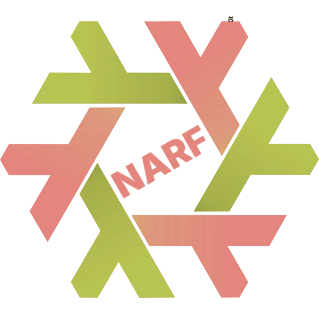

<div align="center">



# narf.nix

_Nix flake for narf – NixOS Advanced Rebuild Flake_

[](CHANGELOG.md)
[](flake.nix)
[](packages/Cargo.toml)
[](https://farbzen.cachix.org)

[Overview](#overview) • [Features](#features) • [Getting Started](#getting-started) • [Applications](#applications) • [Development](#development) • [Deployment](#deployment) • [Documentation](#documentation)

</div>

This repository packages narf as a Nix flake. narf rebuilds a NixOS
configuration flake and records every rebuild as a git commit; it is meant for
NixOS users who manage their systems with a flake in a git repository.

## Overview

The flake builds the Rust workspace under `packages/` and exposes it as
packages and as an overlay for Linux systems (`x86_64-linux`,
`aarch64-linux`).

The workspace consists of the following applications:

- **narf** – command-line tool that updates, rebuilds and commits a NixOS
  flake, built with [clap](https://docs.rs/clap) and
  [cliclack](https://docs.rs/cliclack). The code lives in `packages/narf/`.
- **narf-tui** – terminal UI frontend for narf, built with
  [ratatui](https://ratatui.rs) and [tui-term](https://docs.rs/tui-term). The
  code lives in `packages/narf-tui/`.

Flake outputs:

| Output                       | Content                                 |
| ---------------------------- | --------------------------------------- |
| `packages.<system>.narf`     | both binaries, `nix run` starts `narf`  |
| `packages.<system>.narf-tui` | same build, `nix run` starts `narf-tui` |
| `packages.<system>.default`  | alias for `narf`                        |
| `overlays.default`           | adds `narf` and `narf-tui` to `pkgs`    |

## Features

- **Rebuild as commit**: every new generation is committed with host,
  generation number, NixOS and kernel version in the message.
- **Input updates**: update all flake inputs (`-u`) or selected ones (`-U`)
  before rebuilding.
- **Git sync**: pull before (`-p`) and push after (`-P`) the rebuild, with
  unpushed rebuild commits squashed into one.
- **Safe modes**: dry run (`-d`), build without switching (`-b`) and skipping
  unchanged flakes (`-n`).
- **Remembered flake**: the flake path is saved in `~/.config/narf/flake`, the
  host defaults to the current hostname.
- **TUI**: pick options in a form, see the repository state (upstream,
  unpushed commits, changes, inputs) and run narf in an embedded terminal.

## Getting Started

### Prerequisites

- [Nix](https://nixos.org) with the `nix-command` and `flakes` features enabled

### Try it

```sh
nix run github:farbzen/narf.nix -- --help
nix run github:farbzen/narf.nix#narf-tui
```

### Install on NixOS

```nix
{
  inputs.narf.url = "github:farbzen/narf.nix";

  outputs = {nixpkgs, narf, ...}: {
    nixosConfigurations.<host> = nixpkgs.lib.nixosSystem {
      modules = [
        {
          nixpkgs.overlays = [narf.overlays.default];
        }
        ({pkgs, ...}: {
          environment.systemPackages = [pkgs.narf];
        })
      ];
    };
  };
}
```

> [!NOTE]
> `narf` and `narf-tui` are the same derivation; installing one of them puts
> both binaries on the `PATH`. Both are wrapped with
> [nh](https://github.com/nix-community/nh) and git, which narf calls for the
> rebuild and the commits. nix and nixos-rebuild are bundled as a fallback; the
> system's versions take precedence.

### Binary cache

Prebuilt packages for the locked nixpkgs revision are served from
[farbzen.cachix.org](https://farbzen.cachix.org):

```nix
{
  nix.settings = {
    extra-substituters = ["https://farbzen.cachix.org"];
    extra-trusted-public-keys = ["farbzen.cachix.org-1:8KQga60LYPZVg0E4iKZgQhTmI5dV38Mb9iSuryp8BoY="];
  };
}
```

> [!TIP]
> Cache hits require narf's own nixpkgs input. With
> `inputs.narf.inputs.nixpkgs.follows = "nixpkgs"` the packages are built
> locally.

## Applications

### narf

```sh
narf --update --push      # update inputs, rebuild, commit and push
narf --dry                # only show what would be done
narf -U nixpkgs -b        # update only nixpkgs, build without switching
```

Without `--flake`, narf reads the flake path from `~/.config/narf/flake` and
offers to save a new `--flake` value there. All options: `narf --help`.

### narf-tui

```sh
narf-tui
```

## Development

### Development environment

```sh
git clone https://github.com/farbzen/narf.nix.git
cd narf.nix
devenv shell              # or: direnv allow
```

[devenv](https://devenv.sh) provides the Nix tooling; the `.envrc` loads it
automatically with [direnv](https://direnv.net).

### Build and check

```sh
nix build .#narf          # build the workspace
nix flake check           # evaluate all outputs
nix run nixpkgs#alejandra -- flake.nix packages/default.nix
```

> [!IMPORTANT]
> Flakes only see files tracked by git. Run `git add` on new files before
> `nix build` or `nix flake check`.

## Deployment

A GitHub Actions workflow checks nixos-unstable every six hours, commits a
newer nixpkgs revision to `flake.lock` and pushes the packages for
`x86_64-linux` and `aarch64-linux` to the binary cache. Details in
[docs/deployment.md](docs/deployment.md).

## Documentation

- [Deployment and binary cache](docs/deployment.md)

- [Changelog](CHANGELOG.md)
